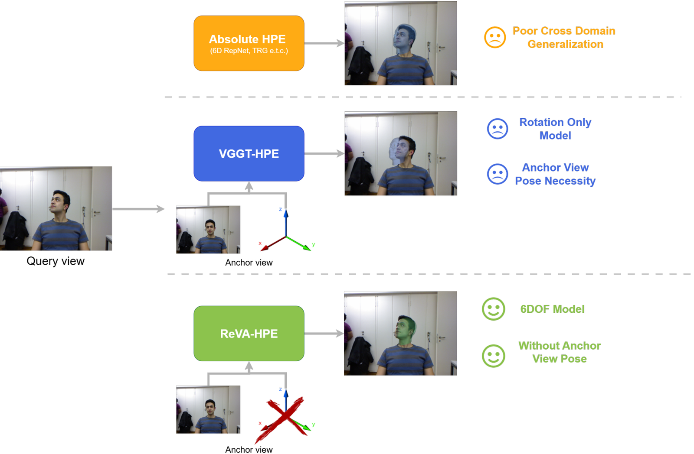
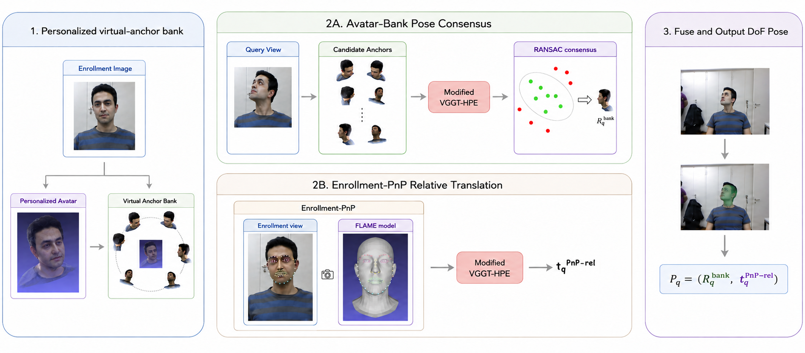
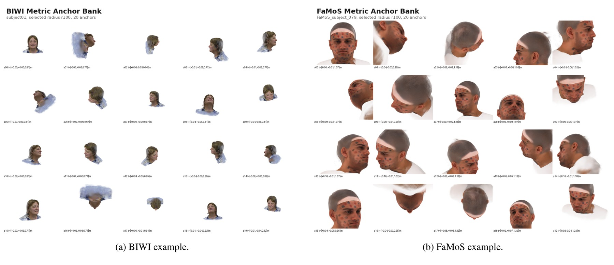
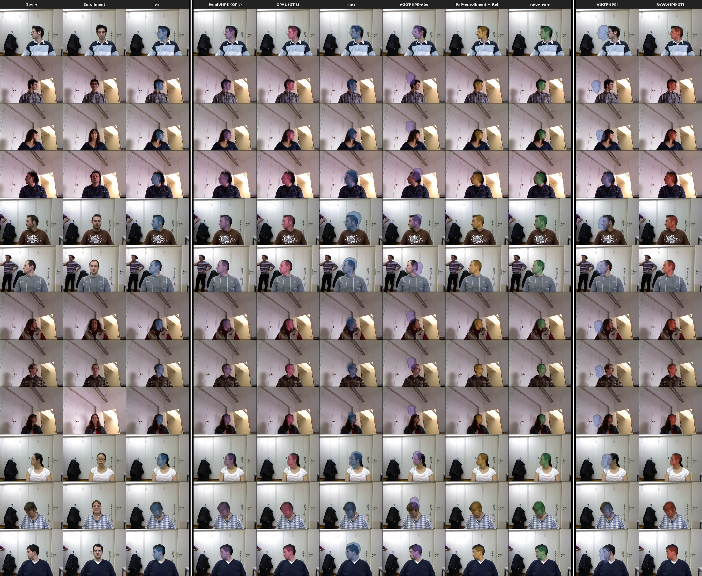
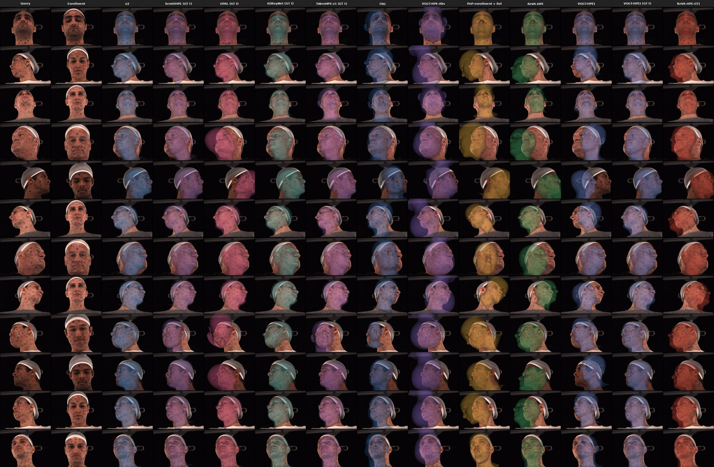

<div align="center">
<h1>ReVA-HPE: Relative 6DoF Head Pose Estimation with Synthetic Pose Supervision and Personalized Virtual Anchors</h1>

**[Vasiliki Vasileiou](https://vasilikivas.github.io/)<sup>1,2</sup>, [Panagiotis P. Filntisis](https://filby89.github.io/)<sup>1,2,3</sup>, [Petros Maragos](https://robotics.ntua.gr/members/maragos/)<sup>1,2,3</sup>, [Kostas Daniilidis](https://www.cis.upenn.edu/~kostas/)<sup>3,4</sup>**

<sup>1</sup>National Technical University of Athens &nbsp; <sup>2</sup>HERON, Hellenic Robotics Center of Excellence &nbsp; <sup>3</sup>Robotics Institute, Athena RC
<sup>4</sup>University of Pennsylvania

[](https://vasilikivas.github.io/ReVA-HPE/)
[](https://vasilikivas.github.io/ReVA-HPE/)
[-red.svg)](LICENSE.txt)
[](https://huggingface.co/Sila97/ReVA-HPE)

</div>



<br>

This repository contains the official implementation of the WACV 2027 paper:
**ReVA-HPE: Relative 6DoF Head Pose Estimation with Synthetic Pose Supervision and Personalized Virtual Anchors**

# Contents
1. [News](#news)
2. [Overview](#overview)
3. [Installation](#installation)
4. [Data Preparation](#data-preparation)
5. [Checkpoints](#checkpoints)
6. [Evaluation](#evaluation)
7. [Training](#training)
8. [Results](#results)
9. [Citation](#citation)
10. [Acknowledgements](#acknowledgements)

# News
- **2026/10**: ReVA-HPE is accepted at WACV 2027! 🎉
- **2026/10**: Code released.
- **2026/10**: The paper PDF and the trained checkpoint are available.

# Overview

ReVA-HPE estimates **metric 6DoF head pose without a ground-truth anchor
pose**. From a single unlabeled enrollment image we reconstruct a personalized
Gaussian avatar and render it into a bank of **virtual anchors** with known
poses: query rotation comes from pose-consensus RANSAC over the bank, and
metric translation from one enrollment landmark-PnP solve combined with the
learned depth-normalized relative translation. The relative estimator (the
VGGT backbone frozen and adapted with LoRA, plus a fine-tuned camera
head) is trained purely on procedural
FLAME renderings — no real pose supervision, pseudo-labels, or fine-tuning on
the evaluation sets. A fast variant (**VA-fast**) uses the bank once at
enrollment and then needs a single real-to-real prediction per query.





```
vggt/              VGGT model code with the relative-6DoF head adaptations
training/          trainer, depth-normalized translation loss, Hydra configs
evaluation/        BIWI bank evaluator, PnP+relative evaluator, synthetic eval,
                   pair-manifest builder, VA-fast composer
reva/avatar_pipeline/  FaceLift -> multiview landmarks -> FLAME fit -> similarity
                   -> metric virtual-anchor banks, enrollment EPnP
reva/experiments/  FaMoS evaluators and protocol utilities
scripts/           entry points used below
protocols/         frozen BIWI query keys / enrollments, FaMoS 188-query keys
```

# Installation
The code is tested with Python 3.10 and PyTorch 2.2.2+cu121 on Linux.

```bash
git clone https://github.com/VasilikiVas/ReVA-HPE
cd ReVA-HPE
conda env create -f environment.yml
conda activate reva-hpe
pip install -r requirements-avatar.txt   # only needed for the avatar pipeline
cp assets.env.example assets.env         # edit the paths inside
```

# Data Preparation

**BIWI** (evaluation): obtain from the original authors (Fanelli et al., IJCV
2013, ETH license) and point `BIWI_ROOT` at:
```
faces_0
├── 01 .. 24
│   ├── rgb.cal
│   ├── frame_*_rgb.png
│   ├── frame_*_pose.txt
├── 01.obj .. 24.obj       # per-subject meshes, required by the PnP branch
```

**FaMoS** (evaluation): obtain from [MPI:IS](https://tempeh.is.tue.mpg.de/)
under their license. The 188 evaluated query identifiers are frozen (without
labels) in `protocols/famos_188_query_keys.csv`.

**Synthetic training corpus**: procedural FLAME renderings (Blender 3.6.23)
converted to fixed focal length. We cannot redistribute the data (FLAME/HAAR
are MPI-licensed) — the generation process and seeds are described in
[DATA.md](DATA.md).

# Checkpoints

| Model | Notes |
|---|---|
| ReVA-HPE `checkpoint_410.pt` | [huggingface.co/Sila97/ReVA-HPE](https://huggingface.co/Sila97/ReVA-HPE) — in [CHECKPOINTS.md](CHECKPOINTS.md) |
| VGGT-1B `model.pt` (frozen base) | download from [facebookresearch/vggt](https://github.com/facebookresearch/vggt) |

Set `VGGT_BASE_CHECKPOINT` and `REVA_HPE_CHECKPOINT` in `assets.env`.
Third-party baselines and their pinned commits are listed in
[CHECKPOINTS.md](CHECKPOINTS.md). The wrapper scripts source `assets.env`,
which takes precedence over inherited environment variables, to change one
of its variables for a single run, point `ASSET_ENV` at an alternative file.

# Evaluation

**BIWI, practical ReVA-HPE** (Direct-5r: M=20 directions x 5 radii):

```bash
scripts/eval_biwi_direct5r_subject.sh 1      # per-subject bank consensus, repeat for 1..24
scripts/aggregate_biwi_direct5r.sh           # aggregate the 24 subjects
scripts/eval_biwi_pnp_relative_subject.sh 1  # enrollment-PnP + relative translation branch
scripts/fuse_biwi_reva.sh                    # fuse rotation + translation
```

The fuse step loads every pairwise candidate (~1.6M rows for the full
protocol) and needs on the order of 64 GB of RAM — run it on a compute node.

Direct-1r uses a single bank (`BANK_NAMES=metric_anchor_bank_front20_r100`)
other bank sizes M come from regenerating banks with `--anchor-count M`.

**FaMoS**:

```bash
python reva/experiments/build_cross_dataset_refinement_inputs.py --protocol famos_view00_mtcnn_visible_no091 ...   # build the driver CSV
scripts/eval_famos_direct5r_subject.sh FaMoS_subject_001                 # bank consensus, per subject
python reva/experiments/aggregate_famos_facelift_bank_hybrid.py ...      # aggregate subjects
python reva/experiments/eval_famos_enrollment_anchor_direct.py ...       # enrollment-PnP + relative translation
```

FaMoS row rotation comes from the bank-consensus ("FaceLift metric bank RANSAC") row 
and translation from the enrollment-PnP hybrid row, the hybrid row's rotation columns 
mix GT conventions.

**VA-fast**: run the bank evaluator once per subject in calibration mode, then
compose each query on CPU:

```bash
BANK_NAMES=metric_anchor_bank_front20_r100 OUTPUT_DIR=outputs/vafast_calib/calib_nd20 scripts/eval_biwi_direct5r_subject.sh 1 --frame-selection enrollment_only
python evaluation/compose_vafast.py --calib-root outputs/vafast_calib --pnprel-root outputs/biwi_pnp_relative \
    --alignment-root "$BIWI_PNP_ALIGNMENT_ROOT" --biwi-root "$BIWI_ROOT" --out outputs/biwi_vafast
```

**Avatar banks**: prebuilt banks are not distributed (they render dataset
subjects). Rebuild each subject's bank from its enrollment image with the
stage scripts in `reva/avatar_pipeline/`, in order:
`run_facelift_no_video.py` (FaceLift reconstruction) ->
`render_three_yaw_views.py` (calibrated avatar views, run for yaw and pitch) ->
`detect_multiview_landmarks.py` -> `triangulate_multiview_landmarks.py` ->
`fit_enrollment_flame_landmarks.py` (FLAME fit on the enrollment image) ->
`align_facelift_to_flame.py` (metric similarity alignment) ->
`generate_metric_anchor_bank.py` with 20 front-hemisphere directions, once per
radius scale 0.85/0.95/1.00/1.05/1.15 (`--base-depth-scale`). The evaluators
expect each bank at
`<bank root>/subjectNN/metric_anchor_bank_front20_rXXX/anchors.json`
with rXXX in {085, 095, 100, 105, 115}.

FaceLift is wired through each stage's `--facelift-root` argument (a FaceLift
checkout with its released checkpoints under `checkpoints/`). The
reconstruction, view-rendering, and bank-rendering stages run inside
FaceLift's own environment, the landmark, triangulation, FLAME-fit, and
alignment stages run in this repository's environment with
`requirements-avatar.txt`. Render the views to `<views root>/yaw` and
`<views root>/pitch` — the landmark stage expects exactly those two
subdirectories. On offline compute nodes, let FaceLift download its
auxiliary weights (VGG19, u2net) once on a connected node first, it fetches
them at first use.

# Training

```bash
OUTPUT_DIR=outputs/train scripts/train_paper_model.sh
```

Config: `training/config/flame_fromvggt_largepairs_fixed_fov_unified_crop_depth_norm_delta_t_rot1_vggtinit.yaml`
(LoRA r=8/alpha=16 on the frozen VGGT-1B backbone with a fine-tuned camera
head, losses lambda_R=1,
lambda_T=1, lambda_F=0.5, fixed 1M-pair manifest). Trains on a single
A100-64GB-class GPU.

# Results

Shared MTCNN protocol, rotation MAE in degrees, translation MAE in
millimeters. "First frame" uses each subject's first available frame as
enrollment, "near-frontal" selects, per subject, an enrollment frame whose
ground-truth pose has max(|yaw|, |pitch|, |roll|) <= 15° (labels are used for
enrollment selection only). The shipped wrappers evaluate the first-frame
protocol, reproducing the near-frontal rows additionally requires re-running
enrollment with the selected frames.

| Method | BIWI MAEr | BIWI MAEt | FaMoS MAEr | Pose supervision |
|---|---|---|---|---|
| 6DRepNet | 3.91 | — | 5.98 | mixed |
| SemiUHPE | 3.20 | — | 2.86 | real |
| TRG | 5.15 | 48.71 | 5.59 | mixed |
| VGGT-HPE-Abs | 5.15 | — | 18.29 | synthetic |
| **ReVA-HPE (first frame)** | **2.53** | 17.10 | 3.78 | synthetic |
| **ReVA-HPE (near-frontal)** | **2.49** | 18.94 | **2.47** | synthetic |

Full per-axis tables, the GT-anchor oracle block, and the bank-size/VA-fast
trade-off are in the paper and on the
[project page](https://vasilikivas.github.io/ReVA-HPE/).





# Citation
If you find ReVA-HPE useful in your research, please consider starring ⭐ the
repository and citing 📚 the paper:

```bibtex
@inproceedings{vasileiou2027revahpe,
  title={ReVA-HPE: Relative 6DoF Head Pose Estimation with Synthetic Pose Supervision and Personalized Virtual Anchors},
  author={Vasileiou, Vasiliki and Filntisis, Panagiotis P. and Maragos, Petros and Daniilidis, Kostas},
  booktitle={Proceedings of the IEEE/CVF Winter Conference on Applications of Computer Vision (WACV)},
  year={2027}
}
```

# Acknowledgements
Our code builds on [VGGT](https://github.com/facebookresearch/vggt) (research
license, retained as `LICENSE.txt`), the vendored `vggt/` tree is upstream
commit `44b3afb` with our additions (LoRA adapters, extra pose encodings,
Euler helpers, camera-head options). We use
[FaceLift](https://github.com/weijielyu/FaceLift) for avatar reconstruction
and [FLAME](https://flame.is.tue.mpg.de/) for the synthetic training data. We
thank the EuroHPC Joint Undertaking for access to Leonardo (CINECA).
